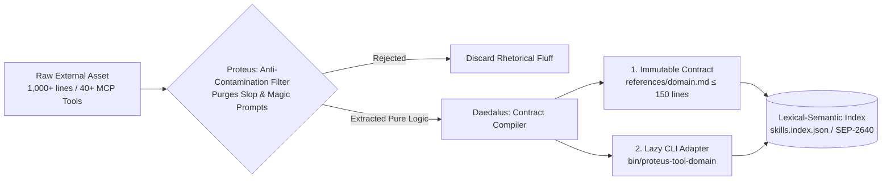
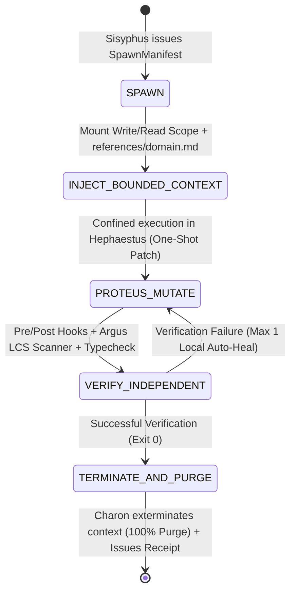
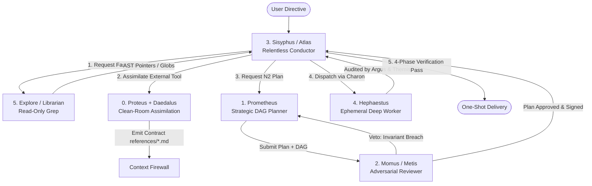
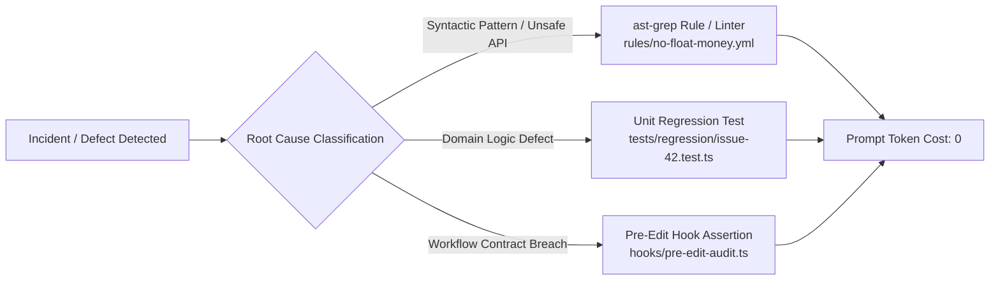

# PROTEUS ENGINE: MASTER SPECIFICATION FOR SKILL ASSIMILATION & EPHEMERAL SUBAGENT ORCHESTRATION (PROTOCOL v1.0)

**Classification:** Frontier Agentic Systems Architecture Specification  
**Ecosystem Compatibility:** Google Antigravity, Oh-My-Antigravity, Claude Code, Cursor, Cline, and Multi-Model Agent Swarms  
**TRIZ Objective (Contradiction Resolution):** Maximize horizontal assimilation of complex third-party capabilities (external repos, massive MCP servers, community frameworks) while maintaining global context entropy at **absolute zero**, guaranteeing constant $O(1)$ latency in the orchestrator prefix and **One-Shot Convergence**.

---

## MODULE 1: THE CLEAN INGESTION & DISTILLATION PIPELINE

No external skill, open-source repository, or third-party MCP server is granted direct execution or read permissions in production. Every external asset is treated as **hostile code contaminated with prompt debt** until it passes through the clean-room distillation pipeline governed by **Proteus** and **Daedalus**.



### 1.1 Clean-Room Distillation Methodology

When assimilating an external skill or massive MCP server, the ingestion engine executes a strict binary partition into two decoupled artifacts:

1. **Immutable Reference Contract (`references/{domain}.md`):**
   * **Hard Physical Limit:** $\le 150$ lines (mechanically verified via `wc -l` hook).
   * **Permitted Content:** Input/output signatures, domain invariants, deterministic error codes, and security constraints.
   * **Prohibited Content:** Wordy examples, step-by-step tutorials, philosophical justifications, or role-prompting ("Act as an expert in...").

2. **On-Demand Executable CLI Adapter (`bin/proteus-tool-{domain}`):**
   * Instead of injecting 40 MCP JSON tool schemas into the *system prompt* (which burns 8,000 to 15,000 tokens before Turn 1), the tool is encapsulated behind a single CLI binary invokable via shell or ephemeral worker.
   * The adapter exposes a standard UNIX interface (`--help`, `--schema`, `--exec`, `--dry-run`), outputting exclusively structured JSON to `stdout` and diagnostic traces to `stderr`.

---

### 1.2 Anti-Contamination Protocol (Purging External Debt)

Before compiling `references/{domain}.md`, **Proteus** subjects the source text to a lexical and structural sanitization matrix:

| Detected Contamination Vector | Example in External Skill | Proteus Action |
| :--- | :--- | :--- |
| **Emotional Coercion ("Magic Prompts")** | *"This is critical for my career, take a deep breath and make no mistakes..."* | **100% Elimination.** Replaced by compiler-verifiable invariants. |
| **Redundant Style Guidelines** | *"Write clean, modular, well-commented code without bugs..."* | **100% Elimination.** Style compliance is enforced by static linters and the Argus LCS scanner. |
| **Inflated Few-Shot Examples** | 400 lines of generic sample code blocks. | **Type Signature Compression.** Only the 15-line TypeScript/JSON Schema contract is preserved. |
| **Fragile Environment Assumptions** | Hardcoded paths (`/Users/dev/...`), implicit `npm` or global variables. | **Strict Parameterization.** Converted into environment variables validated on startup. |
| **Conversational Directives** | *"First greet the user, then explain your plan in detail..."* | **Immediate Purge.** Subagents operate silently and output structured receipts. |

---

### 1.3 Canonical Reference Contract Template (`references/{domain}.md`)

Every contract generated by **Daedalus** must strictly conform to this template:

```markdown
# DOMAIN CONTRACT: [DOMAIN_NAME]
- **ID:** `skill.[domain].v1`
- **Adapter CLI:** `bun run bin/proteus-tool-[domain].ts`
- **Max Blast Radius:** `N0 | N1 | N2`
- **Read Scope:** `[glob_patterns]`
- **Write Scope:** `[glob_patterns]`

## 1. DOMAIN INVARIANTS (HARD CONSTRAINTS)
1. [Invariant 1: Mathematical or state condition that MUST NEVER be violated].
2. [Invariant 2: Concurrency, typing, or memory constraint].

## 2. CLI ADAPTER INTERFACE
| Subcommand | Input Payload (JSON) | Guaranteed Output (`stdout`) | Exit Code (`exit`) |
| :--- | :--- | :--- | :--- |
| `inspect` | `{"target": "string"}` | `{"ast_hash": "string", "nodes": number}` | `10: TARGET_NOT_FOUND` |
| `mutate` | `{"patch": "string", "dryRun": boolean}` | `{"applied": boolean, "diff_lines": number}` | `20: INVARIANT_VIOLATION` |

## 3. PROHIBITED PATTERNS (ANTI-PATTERNS)
- FORBIDDEN to invoke [X] without prior validation of [Y].
- FORBIDDEN to mutate state outside `Write Scope`.

## 4. CONVERGENCE VERIFICATION
Atomic verification command: `bun test [specific_path] && bun run typecheck`
```

---

### 1.4 Dynamic Indexing Specification (SEP-2640 / Lazy Discovery)

Preloading `references/*.md` into the primary orchestrator's context is strictly prohibited. Capability discovery operates under **SEP-2640 (Lazy Capability Discovery)**:

1. **Minimal Footprint Manifest (`skills.index.json`):** A static on-disk index where each capability takes $< 30$ tokens (`id`, `triggers`, `cli_path`, `ref_path`).
2. **Just-In-Time (JIT) Resolution:** The Orchestrator queries the index via a single discovery command (`proteus search --query "<intent>"`).
3. **Ephemeral Mounting:** The engine returns only the `ref_path` pointer. **The orchestrator never reads the contract text**; it simply injects the reference path into the ephemeral worker tasked with execution.

---

## MODULE 2: CONTEXT FIREWALL & EPHEMERAL LIFECYCLE (THE SUBAGENT FIREWALL)

### 2.1 The Context Firewall Rule (**Cerberus**)

The primary orchestrator experiences irreversible cognitive degradation (*Lost-in-the-Middle* and attention diffusion) whenever its context window absorbs build logs, source code dumps, or library documentation.

> [!IMPORTANT]
> **Operational Blindness Axiom:** The Orchestrator is **architecturally forbidden** from executing deep code-reading tools (`read_file` on implementation) or loading reference contracts (`references/*.md`). Its context window may only contain:
> 1. The high-level task Directed Acyclic Graph (DAG).
> 2. Ephemeral dispatch manifests (`SpawnManifest`).
> 3. Structured cryptographic/audit receipts (`ExecutionReceipt`).

---

### 2.2 The 5-State Lifecycle of an Ephemeral Worker (**Charon**)

Subagents operate as isolated processes with volatile memory and zero persistence between invocations, managed by **Charon**:



1. **`SPAWN`:** Clean process instantiated with compressed system prompt ($< 190$ lines) and temperature pinned at `0.0` / `top_p: 1.0`.
2. **`INJECT_BOUNDED_CONTEXT`:** Runtime mounts only the requested `references/{domain}.md` contract and exact lexical slices within `read_scope`. Zero prior user chat history.
3. **`PROTEUS_MUTATE`:** The worker applies the surgical mutation using lexically anchored patches, strictly bounded by `write_scope`.
4. **`VERIFY_INDEPENDENT`:** Before the worker can claim success, the execution harness runs independent verification hooks: `typecheck`, unit tests, and the **Argus** LCS Diff-Scoped scanner.
5. **`TERMINATE & PURGE`:** **Charon** kills the worker process. 100% of the tokens consumed during documentation reading, AST parsing, and intermediate tests are freed from memory. The orchestrator receives only the `ExecutionReceipt` ($< 250$ tokens).

---

### 2.3 Formal Handoff Contract (`SpawnManifest` & `ExecutionReceipt`)

```typescript
// contracts/handoff.schema.ts
export interface SpawnManifest {
  readonly taskId: string;
  readonly targetRole: "HEPHAESTUS" | "EXPLORE" | "MOMUS" | "ARGUS";
  readonly riskTier: "N0" | "N1" | "N2";
  readonly skillRef: string; // Pointer: "references/quant-carry.md"
  readonly readScope: readonly string[]; // Allowed glob patterns for reading
  readonly writeScope: readonly string[]; // Allowed glob patterns for mutation ([] if read-only)
  readonly invariantsRequired: readonly string[];
  readonly acceptanceCmd: string; // e.g., "bun test tests/aether.test.ts"
}

export interface FailureTriage {
  readonly failureClass: "INVARIANT_BREACH" | "TEST_FAILED" | "CONTRACT_LIMIT" | "TIMEOUT";
  readonly failingAssertion: string; // Compact summary <= 120 chars
  readonly reproductionCmd: string; // Exact CLI command to reproduce failure locally
  readonly contractExpansionNeeded?: boolean; // Signal to Daedalus if the 150-line contract was insufficient
}

export interface ExecutionReceipt {
  readonly taskId: string;
  readonly status: "CONVERGED" | "REJECTED_BY_HOOK" | "INVARIANT_BREACH" | "ESCALATION_REQUIRED";
  readonly riskTierExecuted: "N0" | "N1" | "N2";
  readonly mutatedFiles: readonly {
    path: string;
    linesAdded: number;
    linesRemoved: number;
    sha256After: string;
  }[];
  readonly verificationProof: {
    typecheckPassed: boolean;
    lcsSlopViolations: number;
    testExitCode: number;
    executionMs: number;
  };
  readonly triage?: FailureTriage; // Populated only on failure or escalation
  readonly architecturalSummary: string; // Max 280 characters. Zero raw code.
}
```

#### 2.3.1 Error Triage & Escalation Protocol
When an ephemeral subagent fails or exceeds its local auto-heal budget (max 1 retry), it does not dump raw stack traces into the global context. Instead, it emits the compact `FailureTriage` packet:
1. **Zero Context Pollution:** Stack traces are compressed into an actionable `failingAssertion` string ($\le 120$ characters).
2. **Deterministic Contract Expansion:** If `contractExpansionNeeded: true`, `Sisyphus` re-dispatches `Daedalus` to compile an extended slice of the contract rather than guessing in the dark.
3. **Escalation to Momus:** If an invariant is breached, the task is handed over to adversarial review before retrying.

---

## MODULE 3: PROOF-CARRYING AUDITS (PCA) DISCIPLINE

Every code mutation must be accompanied by a formal proof of correctness proportional to its **Blast Radius**, verified by **Themis** and **Argus**.

### 3.1 Risk-Tiered Routing

| Tier | Quantitative Scope | Protocol Requirement | Audit Token Overhead |
| :--- | :--- | :--- | :--- |
| **N0** | **$\le 5$ modified lines.** Cosmetic fixes, typos, isolated local constant tweaks with no signature changes. | **Instant Execution:** Direct patch + quick syntax validation (`proteus-post-edit-slop.ts`). Exempt from prior PCA block. | **0 tokens** (Complete bureaucratic bypass). |
| **N1** | **1 to 3 files.** Function logic, local refactors, unit tests without schema or public API mutations. | **Lexical Anchoring + Bounded Diff:** Pre-condition audit (`pre-edit-audit.ts`), strict typecheck, and LCS added-line scan. | **$< 150$ tokens** (Compact PCA). |
| **N2** | **$> 3$ files**, or any mutation to SQL/WAL migrations, auth, public API contracts, financial math, or concurrency. | **Heavy Gate Activation:** Requires prior approval from **Momus**, Data Chain Traceability, State Machine Transition Table, and **Themis** invariant check. | **300 to 600 tokens** (Mandatory Full PCA). |

---

### 3.2 Canonical PCA Block (Mandatory for Tier N2)

```markdown
### [PROTEUS PCA-N2 AUDIT BLOCK]
- **Target Scope:** `src/engine/carry.ts`, `src/db/migrations/004_wal.sql`
- **M1 (Data Chain):** `Payload Ingress (Zod)` → `NormalizedBigInt` → `CarryEngine.compute()` → `SQLite WAL Tx`
- **M4 (State Machine Transitions):**
  | Source State | Trigger Event | Guard Condition | Destination State | Compensation Action (Rollback) |
  | :--- | :--- | :--- | :--- | :--- |
  | `IDLE` | `SIGNAL_DETECTED` | `rvol >= 1.5 && spread > fee` | `HEDGING` | `abortOrderBatch()` |
  | `HEDGING` | `LEG_REJECTED` | `retry_count > 2` | `PANIC_UNWIND` | `marketCloseAllLegs()` |
- **M7 (Preserved Invariants - Themis):**
  1. Combined position delta remains 0 within 1e-6 tolerance.
  2. Zero IEEE 754 floating point arithmetic touching monetary figures; strict scaled `BigInt`.
- **M11 (Lexical Pre-Anchoring):** Line 42 verified: `export class DeltaNeutralCarry {` (SHA match).
```

---

### 3.3 Argus LCS Diff-Scoped Scanner (`proteus-post-edit-slop.ts`)

To prevent technical debt accumulation without penalizing legacy code in existing projects, the mechanical linter inspects **exclusively the added lines (`+`)** computed via *Longest Common Subsequence* (LCS) on the current patch.

```typescript
#!/usr/bin/env bun
// hooks/proteus-post-edit-slop.ts — Argus Mechanical LCS Diff-Scoped Scanner
import { $ } from "bun";

interface SlopRule {
  readonly id: string;
  readonly regex: RegExp;
  readonly reason: string;
}

const FORBIDDEN_SLOP_RULES: readonly SlopRule[] = [
  {
    id: "SLOP-01",
    regex: /\b(TODO|FIXME|HACK|XXX|PLACEHOLDER)\b/i,
    reason: "Prohibited lazy marker: do not defer implementation with comments.",
  },
  {
    id: "SLOP-02",
    regex: /:\s*any\b|\bas\s+any\b/,
    reason: "Type system bypass detected: explicit use of 'any' is forbidden.",
  },
  {
    id: "SLOP-03",
    regex: /@ts-(ignore|nocheck)|eslint-disable/,
    reason: "Illegal diagnostic suppression of compiler/linter.",
  },
  {
    id: "SLOP-04",
    regex: /catch\s*\([^)]*\)\s*\{\s*(\/\/.*)?\s*\}/,
    reason: "Silent exception swallow in empty catch block.",
  },
  {
    id: "SLOP-05",
    regex: /\.\.\.\s*(rest of|existing|implement|code)/i,
    reason: "Lazy truncation comment detected in code diff.",
  },
];

async function scanAddedLinesOnly(): Promise<void> {
  const diffOutput = await $`git diff -U0 HEAD`.text();
  const lines = diffOutput.split("\n");
  let currentFile = "unknown";
  const violations: string[] = [];

  for (const line of lines) {
    if (line.startsWith("+++ b/")) {
      currentFile = line.slice(6).trim();
      continue;
    }
    if (line.startsWith("+") && !line.startsWith("+++")) {
      const addedContent = line.slice(1);
      for (const rule of FORBIDDEN_SLOP_RULES) {
        if (rule.regex.test(addedContent)) {
          violations.push(`[${rule.id}] ${currentFile}: "${addedContent.trim()}" -> ${rule.reason}`);
        }
      }
    }
  }

  if (violations.length > 0) {
    console.error("CRITICAL PROTEUS HOOK REJECTION (ARGUS DETECTED SLOP):");
    for (const v of violations) console.error(`  - ${v}`);
    process.exit(22); // Triggers automatic rollback or subagent correction
  }
}

await scanAddedLinesOnly();
```

---

### 3.4 Zero-Tolerance to Placeholders & One-Shot Convergence

* **Incomplete Code Prohibited:** Comments like `// ... rest of implementation here` or empty mock functions trigger an immediate rollback (`exit 22`).
* **One-Shot Convergence:** A subagent has a maximum of **1 local auto-heal cycle** in `VERIFY_INDEPENDENT`. If it fails to converge immediately, it terminates with `INVARIANT_BREACH` and returns control to the orchestrator. Infinite trial-and-error loops are strictly forbidden.

---

## MODULE 4: THE ARMY'S TAXONOMY (THE PROTEUS PANTHEON & RBAC)

The architecture decouples **planning**, **adversarial review**, **orchestration**, **mutation**, **assimilation**, and **firewall gating**.



### 4.1 Pantheon Role Definitions

| Agent / Role | Mythological Archetype | Inviolable Mission |
| :--- | :--- | :--- |
| **`Proteus`** | God of Mutation & Adaptability | **Skill Ingestor:** Ingests external repos and MCP tools, purging prompt debt and magic prompts. |
| **`Daedalus`** | Master Precision Architect | **Contract Compiler:** Synthesizes the immutable contract `references/{domain}.md` ($\le 150$ lines) and generates lazy CLI dispatchers. |
| **`Cerberus`** | Three-Headed Boundary Guardian | **Context Firewall:** Forbids code dumps or volatile tokens from leaking into the conductor's session. |
| **`Charon`** | Ferryman of the Dead | **Ephemeral Lifecycle Manager:** Spawns workers in sandboxes and **exterminates them immediately** on completion, freeing 100% RAM. |
| **`Themis`** | Titaness of Divine Law | **Contract & Invariant Guardian:** Formally verifies that mutations do not violate type signatures, RBAC, or invariant constraints. |
| **`Argus`** | Hundred-Eyed Watchman | **LCS Forensic Auditor:** Executes the mechanical scanner over newly added diff lines and audits AST parity. |
| **`Prometheus`** | Forethought and Fire-Bringer | **Strategic Planner:** Builds orthogonal DAG tasks with disjoint write scopes. `write_scope: NONE`. |
| **`Momus`** | Cynical Satirist and Critic | **Hostile Reviewer:** Exercises absolute veto power over plans before execution. Spots race conditions and bloat. |
| **`Sisyphus / Atlas`** | The Titan Rolling the Boulder | **Relentless Conductor:** Drives the closed execution loop without interrupting the user; collects receipts and verifies the 4 phases. |
| **`Hephaestus`** | Divine Smith of the Forge | **Deep Worker:** Implements mutations strictly inside an isolated sandbox under a `SpawnManifest`. |
| **`Explore / Librarian`** | Keeper of the Archives | **Lexical Search:** Maps files and ASTs with ripgrep/fd without mutating code or burning deep-reasoning tokens. |

---

### 4.2 Agentic Role-Based Access Control (RBAC Matrix)

| Agent / Role | Global Search (`grep`/`ast`) | Deep Code Reading | Code Mutation (`patch`) | Shell / Test Execution | Architecture Veto | Context Persistence |
| :--- | :--- | :--- | :--- | :--- | :--- | :--- |
| **`Proteus`** | Yes (External repos) | Yes (Raw external code) | **FORBIDDEN** | Sandbox tests only | No | Ephemeral per Ingestion |
| **`Daedalus`** | Yes | Yes | **Only `references/` & `bin/`** | Contract compilation | No | Ephemeral per Compilation |
| **`Cerberus`** | No | No | **FORBIDDEN** | KV-Cache verification | **YES (Token Leak)** | Resident Guard |
| **`Charon`** | No | No | **FORBIDDEN** | Process Control (Spawn/Kill) | No | Resident Guard |
| **`Themis`** | Yes | Yes (Interfaces/Types) | **FORBIDDEN** | Typechecker verification | **YES (Contract Breach)** | Ephemeral Gate |
| **`Argus`** | Yes | Yes (Only `git diff`) | **FORBIDDEN** | LCS Hook + ast-grep | **YES (Slop Detected)** | Ephemeral Gate |
| **`Prometheus`** | Yes (Via `Explore`) | Interfaces only | **FORBIDDEN** | `--dry-run` only | No | Planning Session |
| **`Momus`** | Yes | Yes (Boundary focused) | **FORBIDDEN** | Static analyzers only | **YES (Plan Veto)** | Ephemeral Review |
| **`Sisyphus / Atlas`** | No (Code-blind) | **FORBIDDEN** | **FORBIDDEN** | 4-Phase Verification Pass | Yes (Receipt Reject) | Clean Main Session |
| **`Hephaestus`** | No | Yes (Only `read_scope`) | **YES (Only `write_scope`)** | Yes (`acceptance_cmd`) | No | **100% Volatile (Purge)** |
| **`Explore`** | **YES (Unlimited)** | Yes (Exact slices) | **FORBIDDEN** | `rg`, `fd`, `ast-grep` only | No | **100% Volatile (Purge)** |

---

## MODULE 5: SELF-OPTIMIZATION WITHOUT DEGRADATION

### 5.1 Resolving the Agentic Learning Dilemma

The most destructive anti-pattern in modern agent engineering is "teaching" the system by appending natural-language warnings to system prompts or rule files (e.g., *"Remember not to use `parseFloat` in the payment module"*). Over time, prompts exceed 2,000 lines, rules contradict, and model attention collapses (**Prompt Drift**).

> [!CAUTION]
> **Law of Volumetric Immutability:** The master core prompt has an inviolable ceiling ($\le 190$ lines). When a bug is fixed, **adding natural language rules to the prompt is forbidden** unless an equal or larger amount of text is removed, or the learning is compiled outside the prompt.

---

### 5.2 Fact-Derived Rules Architecture

Every production bug or audit defect must be compiled into a **deterministic code barrier**, never a linguistic tip:



1. **Unsafe API Patterns → `ast-grep` Rules:**
   If a worker uses `Number()` instead of `BigInt()` in a financial engine, we do not add a prompt warning. We add a 10-line rule to `rules/ast-grep/no-ieee754.yml` that runs in $< 20$ ms inside `VERIFY_INDEPENDENT`.
2. **Edge Cases → Automated Regression Tests:**
   A unit test is committed blocking future regressions.
3. **Outcome:** The system becomes progressively smarter over months while its system prompt remains as lean and sharp as Day 1.

---

### 5.3 Engineering Guidelines for KV-Cache Preservation

Saving 80% to 90% in inference costs and minimizing Time-To-First-Token (TTFT) requires reusing Key-Value tensors (KV-Cache) in initial context blocks. Modifying even one character in early tokens completely invalidates downstream cache.

#### Cache-First Memory Layout

```
+-----------------------------------------------------------------------+
| BLOCK 0: SYSTEM PROMPT CORE (Proteus v1.0 ≤ 190 lines)    [STATIC]    | <-- 100% KV-Cache Hit
+-----------------------------------------------------------------------+
| BLOCK 1: TOOL DEFINITIONS (Alphabetical Order)            [STATIC]    | <-- 100% KV-Cache Hit
+-----------------------------------------------------------------------+
| BLOCK 2: DOMAIN CONTRACT (references/domain.md)           [SEMI-FIXED]| <-- Domain Cached
+-----------------------------------------------------------------------+
| BLOCK 3: RECEIPT HISTORY (Append-Only Receipts)           [INCREMENTAL| <-- Incremental Hit
+-----------------------------------------------------------------------+
| BLOCK 4: CURRENT TASK + TIMESTAMPS / GIT STATUS           [VOLATILE]  | <-- Evaluated Current Turn
+-----------------------------------------------------------------------+
```

#### Golden Rules for KV-Cache Integrity:

1. **No Volatile Metadata in the Prefix:** Never inject current timestamps (`new Date().toISOString()`), git hashes, or turn counters into Block 0 or 1. All temporal telemetry belongs strictly at the end of the user prompt (Block 4).
2. **Deterministic Tool Serialization:** JSON tool schemas must be sorted alphabetically by key (`Object.keys().sort()`). With SEP-2640 lazy discovery, keep a single generic dispatcher (`proteus_exec_cli`) whose JSON signature never changes.
3. **Append-Only History in the Conductor:** Never edit or summarize past turns mid-execution. Because subagents return tiny receipts ($< 250$ tokens), history grows so slowly that it never requires destructive mid-session compaction, preserving a **KV-Cache Hit Ratio $> 92\%$**.
